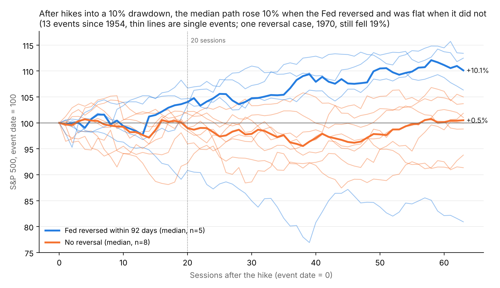

# Peak hawk or 2018 replay? Results

Run date 2026-11-25. Pre-registration commit **eb2faf004a630c26c957c59e96afd3abce11c2d4** (`eb2faf0`), made before any H2, H3 or H4 data was pulled.
Numbers are **verified** (pulled this session, source named) unless starred (*), which means recalled or secondary. Pricing and market levels go stale; re-run `run/A1_fed_priced.py` with a fresh snapshot on 8 Dec.

---

## H1 Peak hawkishness

```
VERDICT: KILLED | confidence 55%
Claim: Waller's remarks and the Oct minutes are a hawkish shift, and they mark peak hawkishness
Method: fedspeak-score (Waller 10 Nov vs 3 Sep/8 Oct) + fed-priced (ZQ futures split) + statement-delta (Oct vs Sep minutes redline)
Data: federalreserve.gov speeches/minutes; CBOT ZQ via IBKR (delayed, 25 Nov 06:20 UTC); run 2026-11-25 | Trials counted: 10
```

| Leg | Pre-registered test | Reading | Result |
|---|---|---|---|
| H1a Waller shift | raw shift >= +1 | **+3.0** (now +6 vs prior +3.0); robustness +1.0 to +2.0 | **Shift: yes** (HAWKISH SURPRISE vs pricing) |
| H1b Pricing already there | cumulative priced through 27 Jan 2027 >= 50bp (floated) | **40.9bp** (45bp sensitivity also fails) | **Not met: hawkish room remains** |
| H1c Minutes vs prior minutes | net score bands | **+2** (hawkish +7, dovish -5, 15 changes): "more hawkish than Sep" | Escalating, not flat |

- **Conclusion:** Waller did shift hawkish, but markets price only about **41bp** of the 50bp he floated by January, and the minutes escalated (two hawkish dissents, "more than 25 basis points could warrant consideration"). Under the pre-registered rule (hawkish room left AND minutes escalating), the "peak" claim is **KILLED**.
- **Fragility, stated plainly:** the minutes score sits on the band edge. Scoring the dissents +1 instead of +2 gives +1 ("flat"), which would make the verdict WEAK. The pre-registered keyword scorer goes the other way: net tone fell from **+0.62 to +0.17** ("net dovish"), which also triggers KILLED, through the other kill branch. **Two of three scorer variants give KILLED, one gives WEAK; none gives HOLDS.**
- **Would change if:** on **9 Dec 2026** the SEP median 2027 dot is at or below 4.125 and the statement drops the firming bias, or if a fresh fed-priced run on **8 Dec** shows >= 50bp priced through January (that would satisfy H1b).
- **Rival explanation:** the minutes look hawkish only because the hold forced the hawks into dissent; the Committee centre (Warsh, "gradual approach", "overall path") may already be at its hawkish limit, which the keyword scorer picks up.
- **Next:** score the December statement against the October statement with `statement-delta` on 9 Dec.

## H2 Insufficient restriction

```
VERDICT: INCONCLUSIVE | confidence 55%
Claim: the policy rate (3.88%) sits below the band of rule-implied rates (Fed behind the curve)
Method: reaction-function: 96 Taylor-type variants (4 rule forms x 4 inflation x 2 gaps x 3 r*) + Kalman TVP rule
Data: FRED latest vintage (PCEPILFE, CPILFESL, PCETRIM12M159SFRBDAL, MEDCPIM094SFRBCLE, UNRATE, NROU, GDPC1, GDPPOT, DFF), 1990Q1-2026Q3 for TVP; run 2026-11-25 | Trials counted: 4
```

| Rule band (low / median / high) | Actual | Priced in 12m | Inflation response b_t now vs pre-hike | Variants |
|---|---|---|---|---|
| **3.18 / 4.20 / 7.38** (width **420bp**) | **3.88** | ~4.54 (Oct 2027 ZQ) | 0.66 (sd 0.10) vs 0.84 in 2025Q4; 1990-2019 mean 0.40 | 96 |

- **Conclusion:** the band is **420bp** wide, above the skill's 200bp limit, so rules cannot settle "behind the curve". The lean is toward "behind": the actual rate is **32bp below the band median**, and **90%** of variants sit above it. Only rules with low r* (0.5) and low-reading inflation measures (trimmed-mean PCE 2.26%) put the rate inside or below.
- With r* fixed at the SEP's 1.2: band **3.88 / 4.19 / 6.58**. The actual rate sits exactly at the low edge, so this is still INCONCLUSIVE by width.
- The Kalman filtered inflation response is **0.66**, down from 0.84 before the September hike but above its 1990-2019 average. Its fitted rate today is **3.67%**, *below* actual. By its own recent behaviour, the Fed is not behind.
- **Would change if:** the 9 Dec SEP longer-run dot moves (each +25bp of r* shifts the band up 25bp), or Oct core PCE (due in December*) breaks away from the 2.3-3.1% spread across inflation measures that drives the band width.
- **Rival explanation:** r* has risen (the Desk survey's longer-run rate moved up to about 3.4%, per the Oct minutes). If so, the high end of the band is right and the Fed is further behind than the median suggests.
- **Next:** add NY Fed HLW r* (host unreachable this session) and real-time ALFRED vintages.

## H3 The 2018 analogy

```
VERDICT: KILLED | confidence 60%
Claim: when the Fed hikes into a >=10% S&P 500 drawdown, a sharp low (within 20 sessions) and a bounce (63-session return > 0) follow
Method: small-sample-truth, beta-binomial (uniform prior; skeptical Beta(8p0, 8(1-p0)) check) + Hoeffding (delta 0.10)
Data: Yahoo ^GSPC daily 1950-2026; FRED DFEDTAR/DFEDTARU (1982-09+), FEDFUNDS monthly proxy (1954-1982); run 2026-11-25 | Trials counted: 14
```

**N = 13 events** (from 175 rate-increase dates; 35 fell in a >=10% drawdown; clustered within 63 sessions). Only **5** are in the 1982+ target-rate sample.

| Sample | Claim | Raw c/n | Posterior mean | 90% interval | Base rate | P(> base) | Verdict |
|---|---|---|---|---|---|---|---|
| Full 1954+ | Sharp low AND bounce (primary) | **5/13** | **0.40** | 0.21-0.61 | 0.45 | 0.34 | **KILLED** |
| Full 1954+ | Low within 20 sessions | 6/13 | 0.47 | 0.26-0.67 | 0.49 | 0.41 | KILLED |
| Full 1954+ | 63-session return > 0 | 8/13 | 0.60 | 0.39-0.79 | 0.61 | 0.48 | KILLED |
| 1982+ target only | Sharp low AND bounce | 3/5 | 0.57 | 0.27-0.85 | 0.44 | 0.76 | WEAK |
| 1982+ target only | Low within 20 sessions | 3/5 | 0.57 | 0.27-0.85 | 0.48 | 0.69 | KILLED |
| 1982+ target only | 63-session return > 0 | 4/5 | 0.71 | 0.42-0.94 | 0.61 | 0.74 | KILLED |

**Key split: did the bounce depend on a Fed reversal?**

| Sample | Bounce with reversal | Bounce without reversal | P(with > without) |
|---|---|---|---|
| Full 1954+ | **4/5** | **1/8** | **0.99** |
| 1982+ | 3/3 | 0/2 | 0.97 |

Event list (O1 = low within 20 sessions, O2 = 63-session return > 0, O3 = reversal within 92 days):

| Date | Source | Drawdown | O1 | O2 | 63d return | O3 | Reversal evidence |
|---|---|---|---|---|---|---|---|
| 1962-06-01 | proxy | -18.3% | 1 | 0 | -1.2% | 0 | none (proxy) |
| 1969-08-01 | proxy | -13.7% | 0 | 1 | +3.7% | 0 | none (proxy) |
| 1970-04-01 | proxy | -15.2% | 0 | 0 | -19.1% | 1 | FEDFUNDS monthly fall 1970-06 |
| 1973-05-01 | proxy | -10.9% | 0 | 1 | +1.0% | 0 | none (proxy) |
| 1974-03-01 | proxy | -16.9% | 0 | 0 | -8.6% | 0 | none (proxy) |
| 1978-12-01 | proxy | -10.0% | 1 | 1 | +1.8% | 0 | none (proxy) |
| 1980-04-01 | proxy | -13.7% | 1 | 1 | +12.5% | 1 | FEDFUNDS monthly fall 1980-05 |
| 1982-01-04 | proxy | -11.1% | 0 | 0 | -6.2% | 0 | none (proxy) |
| 1984-07-05 | target | -11.5% | 1 | 1 | +6.3% | 1 | cut 1984-09-20 |
| 1988-03-30 | target | -23.4% | 0 | 1 | +5.0% | 0 | no cut within 92d (pre-1994: cut-only) |
| **2018-12-20** | target | -15.8% | 1 | 1 | **+13.4%** | 1 | 30 Jan 2019 statement: "the Committee will be patient" |
| 2022-05-05 | target | -13.5% | 0 | 0 | -0.0% | 0 | Jun and Jul 2022 statements raised again |
| 2023-03-23 | target | -14.7% | 1 | 1 | +10.1% | 1 | 14 Jun 2023 statement: "Holding the target range steady" |



- **Conclusion:** as an unconditional rule, "tightening into a drawdown brings a sharp low and a bounce" does **no better than any 10%-drawdown day** (5/13 vs a 45% base rate). The 1982+ subsample leans WEAK, but n = 5. The real content is conditional: **4 of 5 bounces came with a Fed reversal and 1 of 8 without one**. Dec 2018 was a bounce *with* a reversal (the Jan 2019 "patient" statement, verified from the Fed's text).
- **Would change if:** the Fed hikes on **9 Dec 2026** with the S&P 500 at or below **7,037** (10% under the 6 Oct close of 7,818.93). That adds event 14, and its outcome is known about **10 Mar 2027** (63 sessions). On 24 Nov the index was 7.9% off its high, so today's tape is *not yet* an event of this class. The 20 Nov close was -11.6%.
- **Rival explanation:** a reversal is a response to weakness, not a cause of the bounce. Each case is also one regime (1970 reversed and still fell 19%).
- **Next:** extend the event class to hawkish statements from 1994 (pre-registered as not run) and replace the pre-1982 monthly proxy with meeting-dated decisions.

## H4 Wealth channel and credit

```
VERDICT: WEAK | confidence 50%
Claim: tightening is transmitting through financial conditions, and credit is confirming the equity weakness
Method: symptom-evaluation: 5-candidate differential, 9-reading panel across 5 channels (P, C, X, F, R), panel_score.py percentiles vs same-length changes since 2000
Data: FRED (BAA10Y, BAA, GS10, ICE BofA HY/CCC/BB OAS, DFII10, T10YIE, DGS2/10, NFCI, ANFCI, DRTSCILM, ICSA, VIXCLS, VXVCLS); Yahoo (^GSPC, RSP, SPY, CRWV, QQQ); window 6 Oct to 24 Nov 2026 | Trials counted: 5
```

**Leading diagnosis: (c) stress concentrated in an AI and low-grade credit pocket while aggregate conditions stay loose. Confidence: Supported (one observation date).**

Symptom: the S&P 500 fell **7.9%** from its verified 6 Oct 2026 high (7,818.93) to 24 Nov (7,201.09), with a low of **-11.6%** on 20 Nov, while the Fed hiked in September and markets price another hike.

| Ch | Datapoint (change since 6 Oct unless noted) | Reading | Pct vs history | What it says |
|---|---|---|---|---|
| P | S&P 500 drawdown vs 252-session high | -7.9% | 27th | Moderate |
| P | Equal-weight minus cap-weight (log RSP/SPY) | **+8.8 pts** (RSP **+0.8%**, SPY **-7.7%**) | **100th, FLAG** | The average stock has not fallen; the drop is concentrated in the heaviest names |
| C | Baa minus 10y | **+13bp** to 1.59; level at **5th pct** since 2000 | 78th | Aggregate credit not confirming |
| C | CCC minus BB OAS | **+139bp** (10.29 to 11.68) | **92nd, FLAG** (history only since Nov 2023 on FRED) | Stress in the low-quality cohort |
| X | Real 10y (DFII10) | **-12bp** (breakeven -24bp, 10y -35bp, 2y -16bp) | 33rd | Rates eased, not tightened |
| X | 60d corr(S&P returns, d10y) | **+0.17** (was -0.50 at the high) | 38th | Stocks and yields now fall together: growth/risk scare, not a rates shock |
| F | Chicago Fed NFCI since first Oct reading | **+0.02** (to -0.478; ANFCI -0.502) | 66th | No broad tightening; still looser than average |
| R | SLOOS net % tightening C&I | 0.0 to +1.7 (Oct survey) | 62nd | Banks barely tightening |
| R | Initial claims, 4-week average | -0.3% (197,750) | 55th | No labour stress |

Independence rule: 5 channels, 4 non-price, 9/9 verified. Live monitor only (no verdict weight): **CRWV -53.5% vs QQQ -16.0%** since 6 Oct. VIX 35.89 on 20 Nov and 26.62 on 23 Nov; VIX/VIX3M peaked at 1.16 and is 1.04 now. CRWV CDS and the 19 Nov data-centre loan auction remain **UNVERIFIED**.

**Discriminators.**
- (a) vs (b): NFCI change **+0.02** (threshold +0.10) and Baa-10y **+13bp** (threshold +25bp). Neither moved, which points away from (a).
- (b) vs (c): CCC-BB **+139bp** (threshold +100bp) while the aggregate is not confirming, which points to (c).
- (d) composition: the equal-weight drawdown is far less than half the cap-weight drawdown, so the flag fires. I read this as the **equity-side face of the same AI pocket**, not a separate artefact. Daily and monthly Baa spreads agree for October (1.46 vs 1.46), so the monthly-lag artefact is excluded.

Pre-registered flags fired: pocket **TRUE**, aggregate loose **TRUE**, composition **TRUE**, credit confirming **FALSE**, conditions tightening **FALSE**.

- **Conclusion:** tightening is **not** transmitting broadly. Real yields fell, NFCI did not move, IG/Baa spreads sit near 25-year tights, and banks are not tightening. Stress is real but pocketed in AI-linked equity and CCC credit. By the pre-registered map, (c) leading gives **WEAK**. Under a stricter reading, the composition flag alone would make it INCONCLUSIVE. Either way, the "credit confirms a broad wealth-channel squeeze" claim is not supported.
- **Would change if:** by the **9 Dec** meeting, Baa-10y reaches **>= 1.71** (+25bp from 1.46) or NFCI rises **>= 0.10** from -0.494 (weekly, Wednesdays). Then (a) leads.
- **Rival explanation:** (e) benign. This is an AI earnings and capex repricing that would have happened at any policy rate. The panel cannot separate (c) from (e). The Desk's own account in the Oct minutes says the higher-rate environment was "raising credit spreads", which favours (c) over (e), but that is one source.
- **Next:** read the same panel on a second date (after 9 Dec) to reach "Confirmed" or overturn it; add private-credit marks and data-centre ABS spreads if a source becomes reachable.

---

## December FOMC preview (fomc-preview)

**Base case: +25bp to 4.00-4.25% with guidance that more is likely. Confidence 75%. The one number to watch is the median 2027 dot** (Sep: 4.125; market end-2027 about **4.47**, i.e. **+34bp** above the dots).

**What is priced** (ZQ mid quotes, delayed, 25 Nov 2026 ~06:15 UTC; EFFR 3.88 on 23 Nov; EFFR is +0.5bp over the target midpoint):

| Meeting | P(hold) | P(+25) | P(+50) | Implied rate | Cumulative |
|---|---|---|---|---|---|
| 9 Dec 2026 | 0% | **99%** | **1%** | 4.131 | +25.2bp |
| 27 Jan 2027 | 37% | 63% | 0% | 4.287 | +40.9bp |
| 17 Mar 2027 | 38% | 62% | 0% | 4.443 | +56.4bp |
| 28 Apr 2027 | 82% | 18% | 0% | 4.487 | +60.9bp |

Terminal: about **4.55%** (Jul 2027 contract). End-2026 implied 4.13 vs SEP 4.125 (in line). Market is **more hawkish than the dots for 2027**. A search summary put CME FedWatch at 91% / 9% for +25 / +50 on 18 Nov*; this session's own split gives ~1% for +50. The methods differ, so treat the 50bp odds as low but uncertain.

**Since the last meeting:** Oct core CPI **+0.30% m/m** (FRED CPILFESL), which meets Waller's 50bp condition. Waller shifted hawkish (+3.0). The Oct minutes show two hawkish dissents and "a couple" open to more than 25bp. Cook (20 Nov) says financial conditions are "too accommodative"; Bowman (10 Nov) says they "have tightened a bit". The rule band is uninformative (H2). Blackout starts **Sat 28 Nov**. Nov CPI comes out 10 Dec, after the decision*. **data-surprise-map was not run:** there are no consensus forecasts, and BLS/ALFRED release calendars were unreachable (pre-registered fallback).

**Scenario table** (probabilities are judgement, not model output; d2y = 0.6 x (decision minus 25.2bp priced) + guidance term, both judgement; d10y = **0.74** x d2y, beta re-estimated on 223 daily changes in 2026, se 0.04):

| Scenario | Probability (judgement) | Decision | Dots / guidance | Expected d2y | Expected d10y | Channel | S&P read (from H3, H4) |
|---|---|---|---|---|---|---|---|
| Hold | 7% | 0 | Hawkish hold, 2027 hikes kept | **-12bp** | -9bp | path | Closest to a "reversal", the only branch H3 links to bounces; credibility cost |
| **+25bp, signal more** | **78%** | +25 | 2027 median >= 4.375, firming language | **+3bp** | +2bp | path (guidance) | No reversal: H3's no-reversal branch had a median 63d path of **+0.5%** (1 of 8 bounced); index direction set by the AI pocket (H4) |
| +50bp | 15% | +50 | Front-loaded; "enough" language or not | **+13bp** | +10bp | path | Hits the CCC/AI pocket hardest; aggregate credit has room to absorb it |

**Pre-registered conditional reads** (score on 9-10 Dec with fomc-reaction):
1. If **+25bp and the 2027 median dot >= 4.375**, the 2y closes **0 to +8bp** on the day and |d10y| < |d2y|.
2. If **+50bp**, the 2y rises **>= +8bp**, and CCC-BB OAS (10 Dec print) widens while Baa-10y rises **< 10bp**.
3. If **hold**, the 2y falls **>= 8bp** and the S&P 500 closes up **>= 1%** on the day.
4. If the statement adds **explicit patience or pause language** with any decision, the S&P 500 closes up **>= 1%**.
5. Whatever the decision, d10y lies within **0.74 x d2y +/- 5bp** (path-led, not term-premium-led).

**Kill conditions for the base case:** a re-run of fed-priced on **8 Dec** shows P(+50) > 50%; the Fed holds or hikes 50; or the 2027 median dot comes in **below 4.125**.

**Hand-off to fomc-reaction:** Kuttner surprise from the Dec ZQ contract (d = 9, N = 31); 10y split into path vs term premium (ACM was unreachable this session, so use Kim-Wright from federalreserve.gov as fallback and flag it); real (DFII10) vs breakeven (T10YIE); score reads 1-5 and the kill conditions; check whether the Dec 9 close is <= 7,037 (H3 event 14).

---

## Bottom line: peak hawkishness, a 2018 replay, or a Fed still behind the curve?

**None of the three cleanly, but the evidence leans away from "peak" and away from "2018 replay".**
- **Not peak (H1 KILLED, 55%).** Markets still price only **41bp** of the **50bp** Waller floated by January, the minutes escalated in the judgement score, and the SEP is still below market pricing for 2027.
- **Not a 2018 replay yet (H3 KILLED, 60%).** Hiking into a drawdown has **no edge** on its own (**5/13**). The bounces came when the Fed reversed (**4/5** vs **1/8**), and nothing in current guidance or pricing suggests a reversal. Today's drawdown (**-7.9%**) is also not yet in the event class.
- **"Behind the curve" is unprovable with rules (H2 INCONCLUSIVE),** with the band **420bp** wide. But **90%** of rule variants and the market's 12-month path (~**4.5%**) sit above **3.88%**.
- **The wealth channel is not biting broadly (H4 WEAK).** The equity damage is an AI and low-grade-credit pocket; aggregate conditions remain loose (NFCI unchanged, Baa-10y near 25-year tights, real yields down).

That fits the credit/overshoot camp's diagnosis better than Hendry's 2018 framing. Through the wealth channel, policy is not yet doing much outside the AI pocket.

---

## Trial ledger summary (`outputs/ledger.csv`, 37 rows)

| Hypothesis | Tests | Killed / failed | Survived / met | Inconclusive / descriptive |
|---|---|---|---|---|
| H1 | 10 | H1b 50bp **not met**, H1b 45bp **not met**, keyword scorer **net dovish** | H1a shift (4 of 4 variants), redline +2 (2 of 3 variants) | redline with dissents at +1: flat |
| H2 | 4 | none | none | full band, SEP-r* band, non-inertial band all **INCONCLUSIVE**; Kalman descriptive |
| H3 | 14 | **5 of 6 outcome cards KILLED** | none HOLDS | 1982+ primary **WEAK**; 8 descriptive split rows |
| H4 | 5 | credit confirming **FALSE**, conditions tightening **FALSE** | pocket TRUE, aggregate loose TRUE, composition TRUE | |
| Preview | 4 | data-surprise-map **not run** | 2y-10y beta 0.74 | dot gaps 2026 +0bp, 2027 +34bp |

## Deviations from pre-registration

1. **Median CPI series ID.** The pre-registered MEDCPIM158SFRBCLE turned out to be a monthly annualised rate, not y/y. I used the y/y change of the index MEDCPIM094SFRBCLE (the measure that was pre-registered). This moved the H2 band top from 8.19 to 7.38; the verdict (INCONCLUSIVE) is unchanged.
2. **H3 headline sample.** The pre-registration listed full and 1982+ results but did not say which is the headline. I used the full sample, with HOLDS requiring both samples. Full = KILLED, 1982+ = WEAK, so the headline is KILLED.
3. **H4 multiple branches.** Three flags fired at once (pocket, loose, composition). The ordering (a) > (c) > (d) > (b) was coded before the panel was first run but was not written into PREREGISTRATION.md. A stricter reading gives INCONCLUSIVE instead of WEAK.
4. **Pre-1982 proxy dating.** Monthly FEDFUNDS increases are dated at the month start, so the drawdown filter sees a little of the month's data before the rise is fully known (mild look-ahead, flagged).

## Could not verify

- The **18 Nov CNBC Waller interview** (cnbc.com blocked). The 50bp remark rests on the **10 Nov speech**, which is verified and conditional on core CPI around 0.3% or higher.
- "**After a weak equity stretch**": the 10 Nov speech ties 50bp to CPI, not equities. When he spoke, the S&P was below its 6 Oct high, but the speech praises "a booming stock market".
- CRWV CDS levels and the 19 Nov data-centre loan auction; NY Fed ACM and HLW; ALFRED vintages; BLS release text; CME FedWatch.
- The brief's "1.6th percentile" for Oct Baa-10y: this session gets **0.9th** (monthly Baa minus GS10, since 2000). The 1.46pp level matches.

## Reproduce

```bash
cd domestic/quantitative/2026-11-peak-hawk-or-2018/run
python3 A1_fed_priced.py && python3 A2_fedspeak_score.py && python3 A3_reaction_function.py && python3 A4_scenarios.py
python3 B_statement_delta.py && python3 C_small_sample_truth.py && python3 C2_chart.py && python3 D_symptom_evaluation.py
```

A1 reads the saved futures snapshot (`data/raw/futures/`); refresh it via the IBKR connector before re-running for the meeting. FRED and Yahoo pulls are cached in `data/raw/`; delete a cached file to refresh it.
